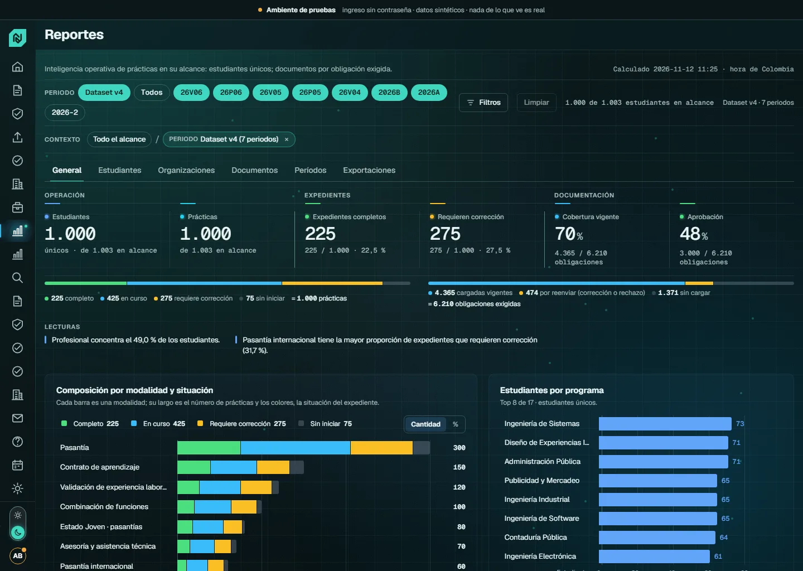
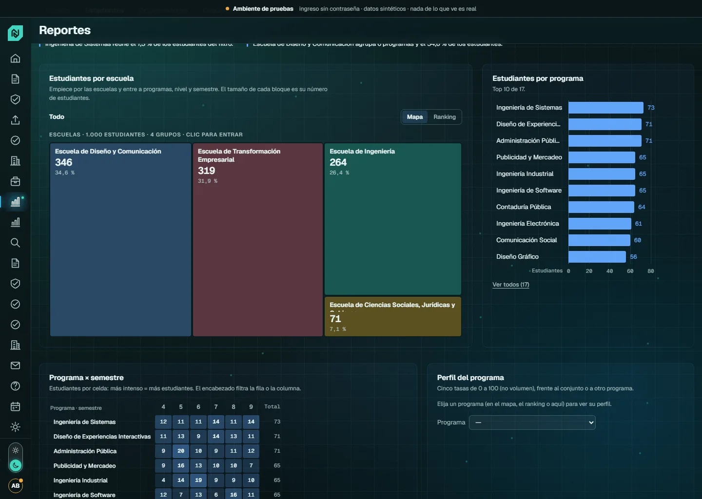
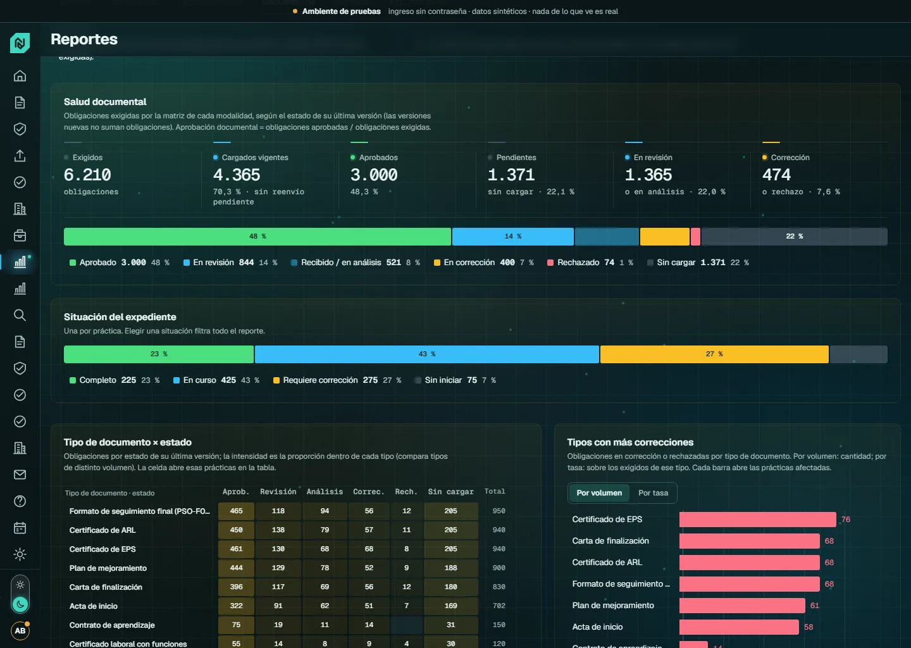
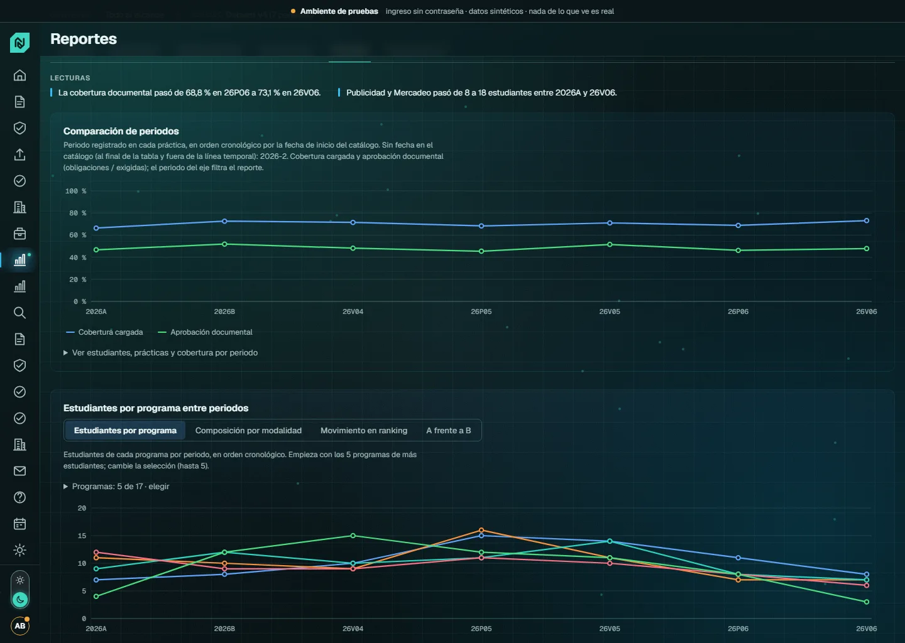
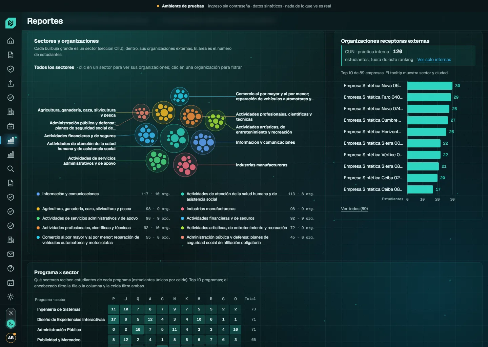
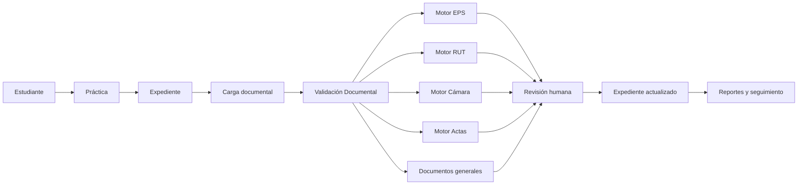
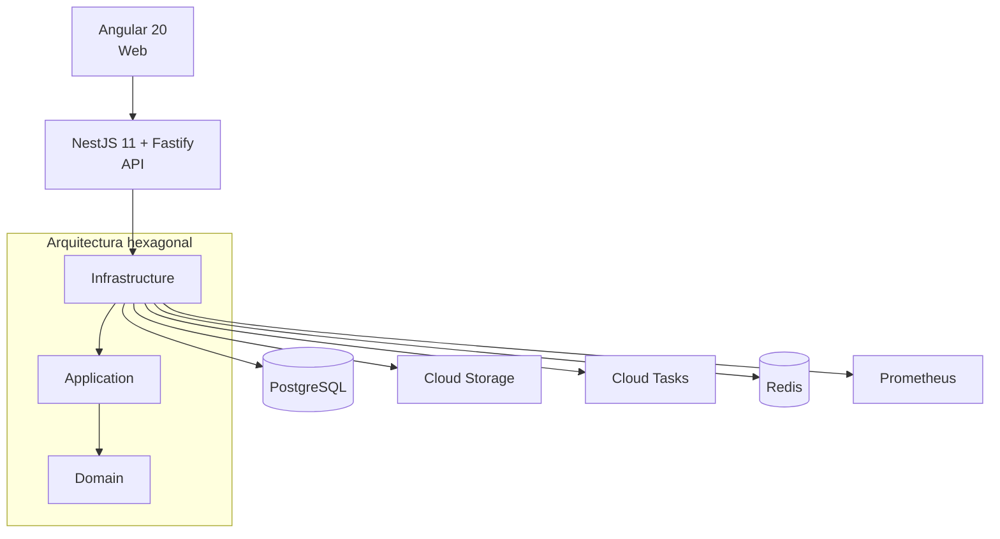

# SIPRA

### Sistema Integrado de Prácticas y Relacionamiento Académico-Empresarial

**Corporación Unificada Nacional de Educación Superior — CUN**

[](https://github.com/haiderbellocun/sipra/actions/workflows/ci.yml)

SIPRA centraliza el ciclo de prácticas, el expediente documental, la validación asistida de soportes y la inteligencia operativa del proceso en una única plataforma institucional.

Su arquitectura separa las reglas de negocio de la infraestructura y combina automatización, validaciones determinísticas y revisión humana para reducir trabajo operativo sin perder trazabilidad ni control.

> **Estado:** desarrollo activo  
> **Stack principal:** Angular 20 · NestJS 11 · Fastify · PostgreSQL · TypeORM · Google Cloud  
> **Documentación técnica:** [`docs/DOCUMENTO-TECNICO.md`](docs/DOCUMENTO-TECNICO.md)

---

## Vista del producto



### Inteligencia operativa

| Estudiantes | Documentación |
|---|---|
|  |  |

| Períodos | Organizaciones |
|---|---|
|  |  |

---

## ¿Qué es SIPRA?

SIPRA es la plataforma para gestionar y acompañar el proceso de prácticas desde el registro inicial hasta el cierre del expediente.

Integra en un mismo producto:

- estudiantes y prácticas;
- períodos académicos;
- modalidades de práctica;
- expediente documental;
- organizaciones receptoras;
- ARL;
- validación documental;
- seguimiento;
- reportes operativos;
- auditoría;
- bolsa de empleo;
- cumplimiento y servicios administrativos.

El objetivo no es reemplazar la decisión humana, sino **automatizar tareas repetitivas, organizar evidencia y presentar información verificable para que el equipo pueda concentrarse en los casos que realmente requieren intervención**.

---

## Experiencia principal



### Mesa Única de Validación Documental

La experiencia operativa principal para los funcionarios es:

```text
/validacion-documental
```

EPS, RUT, Cámara de Comercio y Actas **no son cuatro mesas independientes**.

Son motores especializados que se integran dentro de una misma Mesa Única, manteniendo:

- una cola de expedientes;
- un Document Signal común;
- una bahía de documentos;
- un inspector;
- reservas por documento;
- una barra de decisión consistente;
- permisos propios de cada motor;
- trazabilidad completa.

El funcionario puede revisar diferentes tipos documentales sin abandonar el expediente.

---

## Motores documentales

SIPRA utiliza motores especializados según el documento.

### EPS

- extracción local de información;
- detección de QR cuando existe;
- comparación con datos de SIPRA;
- contraste asistido con ADRES cuando corresponde;
- revisión humana final.

SIPRA **no automatiza CAPTCHA ni realiza scraping no autorizado de ADRES**.

### RUT

- lectura local;
- clasificación persona natural / jurídica;
- NIT y dígito de verificación;
- detección de QR DIAN;
- comparación contra la información de la práctica;
- decisión humana.

### Cámara de Comercio

- clasificación documental;
- información registral;
- representante;
- matrícula;
- fechas;
- comparación con SIPRA;
- revisión humana.

### Actas

Soporta las variantes documentales definidas por el dominio y analiza, entre otros elementos:

- remuneración;
- responsable de ARL;
- firmas;
- comparación con la práctica;
- estado documental.

---

## Expediente

Cada práctica posee un expediente que concentra las obligaciones documentales que realmente le corresponden.

El expediente permite visualizar:

- documentos exigidos;
- documentos pendientes;
- versiones;
- correcciones;
- aprobaciones;
- estado de cada obligación;
- avance global;
- historial;
- información de la práctica.

Las obligaciones se derivan de las reglas de dominio y de la modalidad correspondiente; no se construyen con listas estáticas en la interfaz.

---

# Reportes e inteligencia operativa

Reportes V3 transforma la información operacional de SIPRA en una experiencia de análisis desde lo general hasta el expediente individual.

```text
Institución
    ↓
Período
    ↓
Escuela
    ↓
Programa
    ↓
Nivel de formación
    ↓
Modalidad
    ↓
Organización receptora
    ↓
Sector / Ciudad
    ↓
Estado documental
    ↓
Estudiante
    ↓
Expediente
```

### Dimensiones disponibles

Los reportes pueden analizar información por:

- período;
- escuela;
- programa;
- ciclo de formación;
- modalidad;
- estado de práctica;
- situación del expediente;
- organización receptora;
- sector económico CIIU;
- municipio DIVIPOLA;
- práctica interna CUN / externa;
- tipo documental;
- estado documental.

El semestre se utiliza únicamente en datasets sintéticos de desarrollo cuando la fuente institucional no está disponible.

### Capacidades BI

Reportes incluye:

- filtros cruzados;
- drilldown;
- filtros facetados;
- análisis por programa;
- composición académica;
- salud documental;
- organizaciones receptoras;
- sector económico;
- ciudad;
- análisis temporal por períodos;
- tiempos de decisión;
- exportaciones filtradas;
- navegación directa al expediente.

Las métricas se calculan en el servidor para evitar conteos duplicados por versiones, documentos o relaciones.

---

## Organizaciones receptoras

Las prácticas externas pueden relacionarse con organizaciones receptoras y analizarse por:

```text
Organización
    ├── Sector económico · CIIU
    ├── Municipio · DIVIPOLA
    ├── Estudiantes
    ├── Programas
    ├── Modalidades
    └── Estado documental
```

SIPRA también distingue las prácticas realizadas internamente en la CUN utilizando las reglas existentes de modalidad, sin introducir una segunda fuente de verdad.

---

## Arquitectura

SIPRA es un monorepo npm compuesto por una aplicación Angular y una API NestJS.



### Regla de dependencia

```text
Infrastructure
      ↓
Application
      ↓
Domain
```

El dominio no depende de NestJS, TypeORM, Fastify, PostgreSQL ni Google Cloud.

Esta separación se valida desde el lint del proyecto.

---

## Stack tecnológico

| Capa | Tecnología |
|---|---|
| Frontend | Angular 20 |
| UI | Standalone Components · Signals · OnPush |
| Tipografía | Geist · Geist Mono |
| Backend | NestJS 11 |
| HTTP | Fastify |
| Arquitectura | Hexagonal · Puertos y adaptadores |
| Base de datos | PostgreSQL |
| ORM | TypeORM |
| Caché | Redis |
| Archivos | Google Cloud Storage |
| Procesamiento | Google Cloud Tasks |
| Infraestructura | Docker · Google Cloud |
| Observabilidad | Prometheus |
| API Docs | OpenAPI / Swagger |
| Testing API | Jest |
| Lenguaje | TypeScript |

---

## Estructura del repositorio

```text
sipra/
│
├── apps/
│   ├── api/
│   │   ├── src/domain/
│   │   ├── src/application/
│   │   └── src/infrastructure/
│   │
│   └── web/
│       └── src/app/
│
├── docs/
│   ├── assets/
│   └── DOCUMENTO-TECNICO.md
│
├── infra/
│   ├── docker/
│   └── gcp/
│
├── .github/
│   └── workflows/
│
├── package.json
└── README.md
```

---

# Desarrollo local

## Requisitos

- Node.js `>= 22`
- npm `>= 10`
- Docker / Docker Compose
- PostgreSQL y Redis mediante la infraestructura local del proyecto

### 1. Instalar dependencias

```bash
npm install
```

### 2. Configurar ambiente

Copie:

```text
.env.example
```

como:

```text
.env
```

y configure únicamente las variables necesarias para su entorno.

Nunca agregue credenciales reales al repositorio.

### 3. Levantar infraestructura

```bash
npm run infra:up
```

### 4. Ejecutar migraciones

```bash
npm run migration:run
```

### 5. Cargar catálogos

```bash
npm run catalogos:cargar
```

### 6. Crear datos sintéticos

```bash
npm run seed
```

### 7. Iniciar SIPRA

```bash
npm run dev
```

Servicios locales:

| Servicio | Dirección |
|---|---|
| Web | `http://localhost:4200` |
| API | `http://localhost:3000/api/v1` |
| OpenAPI · desarrollo | `http://localhost:3000/docs/dev-only/swagger` |

---

## Comandos principales

| Comando | Uso |
|---|---|
| `npm run dev` | API + Web |
| `npm run dev:api` | API |
| `npm run dev:web` | Angular |
| `npm test` | Suite API |
| `npm run test:web` | Suite Web + typecheck de pruebas |
| `npm run test:aislamiento` | Verifica aislamiento entre alcances |
| `npm run test:pg` | Pruebas de concurrencia PostgreSQL |
| `npm run lint` | ESLint API + Web |
| `npm run build` | Build de producción |
| `npm run smoke:arranque` | Smoke test del API |
| `npm run migration:run` | Ejecuta migraciones |
| `npm run seed` | Datos sintéticos |
| `npm run catalogos:cargar` | Carga catálogos oficiales |
| `npm run catalogos:estado` | Revisa cobertura de catálogos |

---

# Catálogos institucionales

SIPRA utiliza catálogos estructurados para evitar texto libre en dimensiones críticas.

Entre ellos:

- CIIU;
- DIVIPOLA;
- ocupaciones;
- niveles educativos;
- escuelas;
- períodos;
- modalidades.

La cobertura de cada catálogo se controla mediante herramientas del proyecto y se documenta en el documento técnico.

---

## Validación documental asistida

SIPRA puede apoyar la revisión con lectura documental asistida: extrae los datos de cada soporte, comprueba si cumple los criterios del manual institucional y señala lo que no coincide con la información de la práctica. La lectura se implementa detrás del puerto `ExtraccionIaPort`, de modo que el dominio no depende de ningún proveedor concreto.

Según la configuración y el tipo de documento, la lectura la hace un adaptador determinístico local o un proveedor de IA. Los documentos con datos sensibles —como el certificado de EPS, el acta de iniciación, el RUT o el certificado de Cámara de Comercio— se procesan únicamente con extractores locales y nunca salen a un servicio externo.

La lectura asistida orienta; no decide sola. Ningún documento se rechaza de forma automática, y los documentos inconsistentes, no verificables, de un tipo distinto al esperado o que requieren interpretación pasan a revisión humana. Lo mismo ocurre si el proveedor no responde o si se alcanza un límite de uso.

SIPRA no es una autoridad certificadora: organiza la evidencia para que la persona responsable tome la decisión. El detalle de adaptadores, configuración, controles de gasto y pruebas está en el [documento técnico](docs/DOCUMENTO-TECNICO.md) (sección 19).

---

# Seguridad y privacidad

SIPRA trabaja con información académica y documental, por lo que aplica controles desde la arquitectura y no únicamente desde la interfaz.

Principios implementados:

- autorización basada en roles;
- alcance de información por usuario;
- aislamiento entre organizaciones;
- documentos privados;
- auditoría;
- minimización de datos;
- secretos fuera del repositorio;
- validaciones de configuración por ambiente;
- consentimiento cuando corresponde;
- datos exclusivamente sintéticos en semillas de desarrollo.

Las acciones del frontend nunca sustituyen los controles del backend.

---

## Auditoría

Los eventos relevantes del proceso se registran para mantener trazabilidad de:

- decisiones;
- revisiones;
- descargas;
- cambios de estado;
- operaciones documentales.

La auditoría crítica está diseñada como inmutable a nivel de persistencia.

---

# Diseño

SIPRA utiliza un sistema visual propio orientado a aplicaciones operativas de larga duración.

### Hybrid Signal Dark

Tema oscuro de alta densidad para trabajo operativo.

### Arctic Signal Light

Tema claro con superficies frías y contraste controlado.

### Document Signal

Lenguaje visual utilizado para representar el estado y avance de las obligaciones documentales.

### Principios

```text
Claridad > decoración
Información > tarjetas
Jerarquía > saturación
Consistencia > componentes aislados
```

La interfaz utiliza **Geist** y **Geist Mono**.

---

# Accesibilidad

Las interfaces V3 siguen criterios de accesibilidad para:

- navegación por teclado;
- focus visible;
- estados con texto además de color;
- contraste;
- tablas equivalentes para visualizaciones;
- reduced motion;
- responsive desktop y móvil.

---

# Ambientes

La infraestructura contempla ambientes independientes:

```text
dev
qa
pre
prod
```

Los modos de autenticación abiertos y los datasets sintéticos pertenecen exclusivamente a desarrollo.

Los ambientes superiores requieren autenticación institucional y configuraciones más restrictivas.

---

# Principio de validación documental

SIPRA **asiste** la validación documental.

No debe interpretarse como una autoridad certificadora ni como sustituto de las fuentes oficiales.

Cuando un documento:

- no puede verificarse;
- presenta inconsistencias;
- requiere interpretación;
- depende de una fuente externa;
- o supera las reglas de automatización;

el proceso escala a revisión humana.

---

# Ambiente de pruebas en la nube

Ambiente **permanente** en Google Cloud (proyecto de desarrollo), con datos sintéticos e ingreso sin contraseña. No caduca: los servicios de Cloud Run y la base de datos son fijos; solo la sesión del navegador vence a las ocho horas.

| Recurso | URL |
|---|---|
| Aplicación | https://sipra-web-dev-62q7xac77q-uc.a.run.app |
| API · estado | https://sipra-api-dev-62q7xac77q-uc.a.run.app/api/v1/salud |

En el ingreso cada perfil es una tarjeta; si tiene varias personas, el desplegable «Entrar como» permite elegirla. Los usuarios de prueba (todos sintéticos) se describen en el documento técnico.

Para publicar una nueva versión en ese ambiente: `bash infra/gcp/desplegar.sh` desde Cloud Shell, en la raíz del repositorio.

---

# Transferencia del proyecto

Quien reciba el proyecto debe empezar por la **sección 20 del documento técnico** ([`docs/DOCUMENTO-TECNICO.md`](docs/DOCUMENTO-TECNICO.md), «Guía de transferencia») y seguir con la sección 15 (estado por módulo y backlog verificado).

---

# Antes de producción

Cuatro gestiones no dependen del desarrollo y tienen plazos propios:

1. **Modificación de la autorización ante la Unidad del SPE** — bloquea la bolsa de empleo.
2. **Validación jurídica** de tratamiento de datos y transferencia internacional.
3. **Definición del método de acceso a SINU** con la Dirección de Tecnología.
4. **Archivos oficiales del DANE** (CNO, CIIU, DIVIPOLA completos) y **conciliación del anexo técnico del SPE** con Extensión — sin ellos los reportes regulatorios no son radicables y el sistema los bloquea.

---

# Documentación técnica

La referencia técnica completa vive en:

[`docs/DOCUMENTO-TECNICO.md`](docs/DOCUMENTO-TECNICO.md)

Allí se documentan:

- arquitectura;
- modelo de datos;
- roles y permisos;
- seguridad;
- motores documentales;
- infraestructura;
- despliegue;
- observabilidad;
- pruebas;
- decisiones de arquitectura;
- estado de módulos;
- guía de transferencia;
- bitácora técnica.

El README funciona como **puerta de entrada al producto**.  
El documento técnico es la **fuente de detalle de ingeniería**.

---

# Estado del desarrollo

Actualmente están consolidadas las experiencias principales de:

- ingreso;
- shell y navegación;
- inicio;
- listado de prácticas;
- expediente;
- Mesa Única de Validación Documental;
- motores EPS, RUT, Cámara y Actas;
- Reportes V3;
- temas Dark / Light;
- responsive;
- accesibilidad;
- pruebas automatizadas del flujo principal.

El proyecto continúa evolucionando en módulos administrativos y operativos secundarios.

---

# Licencia

```text
UNLICENSED
```

Proyecto de uso institucional de la **Corporación Unificada Nacional de Educación Superior — CUN**.

No está destinado a distribución o comercialización pública.

---

<p align="center">
  <strong>SIPRA</strong><br/>
  Prácticas · Expediente · Validación documental · Inteligencia operativa
</p>
